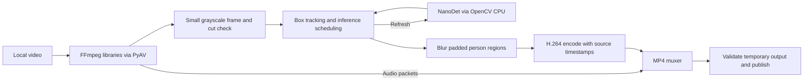

# PureBlur Studio architecture

The development machine reports Windows 10 build 19045, an Intel Core i5-6300U, four logical CPUs and 19.88 GiB of system memory. The bundled Python 3.12 runtime worked. GPU capacity was unavailable from the sandbox. Phase 1 uses the CPU and is designed to share the machine with other work.

## Reference projects and models

| Reference | What applies to this project |
| --- | --- |
| [HaramBlur Android](haramblur-reverse-engineering.md) | Screen capture gating, local box inference, reusable buffers, and temporal box association are applicable design ideas. Measured Android resource usage and protected model accuracy remain unknown. |
| [HaramBlur extension](https://github.com/alganzory/HaramBlur) | The AGPL-3.0 source describes browser-local face and NSFW image/video filtering with TensorFlow.js assets. A live page overlay and its software distribution have different requirements from timestamped offline video export. Its README does not provide an equivalent Windows CPU benchmark or a full-person detector size. |
| [OCCLUDE](https://github.com/anaxoniclabs/OCCLUDE) | Its current README describes an offline three-pass pipeline with RT-DETR tracklets, a 7B Qwen VLM, SAM2 silhouettes and FFmpeg audio remuxing. Code is MIT and weight licenses are separate. The publisher recommends CUDA and describes CPU use for short clips. Borrow the idea of shot-bounded tracking and select lighter components for this hardware. |

- **Person boxes.** [OpenCV Zoo NanoDet](https://github.com/opencv/opencv_zoo/tree/main/models/object_detection_nanodet) supplies Apache-2.0 weights and schema examples. Use the [1,123,958-byte block-quantized ONNX export](https://github.com/opencv/opencv_zoo/blob/main/models/object_detection_nanodet/object_detection_nanodet_2022nov_int8bq.onnx); the [FP32 export](https://github.com/opencv/opencv_zoo/blob/main/models/object_detection_nanodet/object_detection_nanodet_2022nov.onnx) is 3,800,954 bytes. Both loaded on the test CPU at 416 × 416. The graph's fixed reshape prevents arbitrary inference sizes. Evaluate a separately exported 320-pixel model on small and occluded people before replacing it.
- **Silhouettes.** [PP-HumanSeg](https://github.com/opencv/opencv_zoo/tree/main/models/human_segmentation_pphumanseg) supplies Apache-2.0 192 × 192 foreground segmentation weights in standard and block-quantized forms. It produces a semantic person mask. Selecting one person in a crowd requires instance separation or carefully evaluated box-guided masks.
- **Sensitive regions and scenes.** [NudeNet](https://github.com/notAI-tech/NudeNet) is a candidate for body-region boxes, pending verification of the exact release's weight license and a CPU accuracy benchmark. [Falconsai's Apache-2.0 ViT](https://huggingface.co/Falconsai/nsfw_image_detection) provides per-image scores and is too heavy for the first CPU build. A frame-level score does not establish location, sustained contact, or a specific action. No CPU-qualified kissing or appearance model is selected.

## Phase 1 data flow

The CLI uses a single decode-to-export pass for Phase 1. PyAV exposes FFmpeg timestamps and audio packets directly and avoids raw-frame subprocess piping or a scratch video. OpenCV handles the ONNX graph, local motion and ROI blur. A separate runtime, a GUI framework and a GPU SDK would all add size to the first build. The main costs to measure are fixed-size inference, pixel conversion on blurred frames, and H.264 encoding. Model size, installed runtime size and output file size are measured separately.

| Path | Responsibility |
| --- | --- |
| `pureblur/__main__.py` | CLI, resource presets, local validation and run metrics |
| `pureblur/detector.py` | NanoDet inference and coordinate projection |
| `pureblur/tracking.py` | Cut checks, bounded optical flow and detection scheduling |
| `pureblur/video.py` | Timestamped decode, regional blur, audio/subtitle remux and output validation |
| `models/` | Single verified model and upstream license |
| `tests/` | Small deterministic tests and timing regression checks |
| `docs/` | APK evidence, architecture and measured results |

## Development tickets

1. Export one short video with true person detections, padded box blur and unchanged compatible audio. Verify timing, actual pixel blur and CPU resource use.
2. Quantify recall and continuity on varied crowd, cut, occlusion and camera-motion footage. Add timestamped analysis plans and a second render pass where review or first-appearance coverage demands it.
3. Benchmark an optional CPU-friendly silhouette model. Keep the default install to a single detector unless the benefit is measured.
4. Evaluate sensitive region and scene models as opt-in downloads, including licensing, error behavior and a review path.
5. Add the desktop job UI and manual review when the media and timing engine is reliable on long videos.
6. Measure a one-folder Windows package, excluding duplicate video plugins where supported, and test on Windows 10 and Windows 11.
