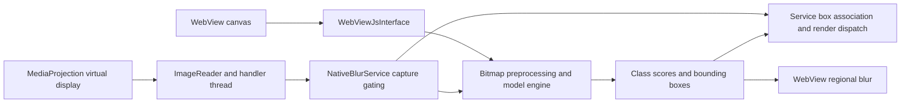

# HaramBlur Android 2.0.6.9 static analysis

Analyzed the three supplied APKs as ZIP archives, decoded their binary manifests, read selected Dalvik instructions with Androguard 3.3.5, and inspected the ARM64 ELF dynamic symbol tables and WebView script. The installed REA skill guided the investigation. This session had Java 8 and no connected REA Android tool or JADX provider, so the code evidence below is Dalvik inspection. The APKs were read in place. No APK code was executed, and model payloads were left protected.

## Package inventory

| APK | Bytes | Entries | SHA-256 |
| --- | ---: | ---: | --- |
| `base.apk` | 41,467,841 | 1,016 | `1e8727f784d73684c50cb6bc0d1c4ced3e7c439f4cb459baa949f31ee9024a8e` |
| `split_config.arm64_v8a.apk` | 4,547,819 | 16 | `c0bd0502e3f5dda6f99d91257970bf241e326bca00f0d8b9bfda851a946ce93a` |
| `split_config.xxhdpi.apk` | 79,482 | 57 | `4ca98771f429041f60f6eeaa2d3375efcb4f36f9d19ab2d3ffaaa0c1830bbb88` |

- **CONFIRMED** `AndroidManifest.xml` identifies `com.haramblur`, version `2.0.6.9`, code `426`, min SDK 24, target SDK 36. Both splits declare `hasCode=false`. The ARM64 split holds ELF libraries. The density split holds resources.
- **CONFIRMED** The base contains a single DEX 037 with 11,463 class definitions, Android resource tables, baseline ART profiles, `assets/haramblur.js`, `labels.txt`, `nsfw.txt`, `model_manifest.json` and the four binary assets listed below. The `nsfw.txt` name alone establishes no model behavior. The manifest also declares Firebase, Play services, billing, and AndroidX components.

## Android integration and rendering

- **CONFIRMED** `MainActivity` is exported. The home, settings, whole-system, PiP guide, native autodetect and model setup activities are internal. Manifest permissions relevant to filtering include `SYSTEM_ALERT_WINDOW`, `FOREGROUND_SERVICE`, and `FOREGROUND_SERVICE_MEDIA_PROJECTION`. The base also requests Internet, network state, notifications, biometric and fingerprint access, wake lock, legacy storage (up to SDK 28), boot reception, billing and advertising-related permissions.
- **CONFIRMED** `HaramBlurAccessibilityService` declares `BIND_ACCESSIBILITY_SERVICE`. Its packaged XML at `res/xml/accessibility_service_config.xml` enables window content retrieval and screenshot capability. `onAccessibilityEvent` reads event type and package name. `NativeBlurService.b` explicitly creates a MediaProjection virtual display feeding an `ImageReader`. The screenshot capability flag alone does not establish a second screen-capture pipeline.
- **CONFIRMED** `NativeBlurService.onStartCommand` starts the foreground notification. Its constructor sets up a HandlerThread and handlers. `onDestroy` detaches the image listener, removes callbacks and stops MediaProjection. `H` adds a window for its projection scope probe. That probe window uses accessibility overlay type 2032 in `i74.<init>`.
- **CONFIRMED** `NativeBlurService.onDetect` passes bounding boxes through `z` and packages results for dispatch through `M`. `z` compares boxes by class and spatial overlap. `L` delivers existing results with capture pixels when available. This is evidence of temporal association and result reuse. **UNKNOWN** The full composition path for the production Android overlay and device-specific render acceleration were not resolved from the selected methods.
- **CONFIRMED** The separate WebView path uses `assets/haramblur.js` with `window.Android.detectVideoFrame`, a capture canvas and CSS/canvas blur. `WebViewJsInterface.onDetect` serializes box coordinates, class and confidence. The script also has an image-processing path and DOM observers.

## Models and detection

| Role or asset | Package path | Wrapped bytes | Declared plaintext bytes |
| --- | --- | ---: | ---: |
| Nano | `assets/models/nano320.bin` | 2,886,079 | 2,886,030 |
| Small | `assets/models/small320.bin` | 10,203,466 | 10,203,417 |
| Legacy | `assets/models/legacy416.bin` | 5,309,761 | 5,309,712 |
| Separate legacy asset | `assets/legacy/data.bin` | 5,309,712 | — |

- **CONFIRMED** `assets/model_manifest.json` names three roles with model IDs, versions and ciphertext hashes. The three manifest-listed files carry an `HBGM` prefix. `HaramDetector.<init>` and `restart` obtain a provisioned buffer through `ModelDecryptor`. `libmodelencryption.so` exports JNI bindings for the protection layer.
- **CONFIRMED** `HaramDetector.a` reads tensor dimensions from engine interface `q71`, logs NHWC/NCHW, constructs bitmap preprocessor `j02`, and rejects outputs without a seven-channel axis. `detect` gets a bitmap in a usable config, invokes the preprocessor and engine, then emits `List<BoundingBox>` or an empty result. `BoundingBox` exposes class index/name, confidence, rectangle and size. The constructor's default-argument helper contains 0.45 and a cap of 50. Its confidence and IoU settings can be changed.
- **CONFIRMED** `LiteRtCpuEngine` has JNI calls to create, retain direct input/output buffers, run and destroy the engine. Corresponding symbols are in `libhb_litert_engine.so`. The split also contains `libLiteRt.so`, `liblitert_jni.so` and `libLiteRtClGlAccelerator.so`. DEX references to TensorFlow Lite are present. The manifest declares a `QnnWorkerService` in `:npu_htp` and an optional NPU feature. APK notices cover Qualcomm QNN LiteRT and the QNN runtime.
- **INFERRED** The role names and `u83.<clinit>` suggest 320-pixel Nano/Small and 416-pixel Legacy inputs. The actual shapes and element types for each protected file require authorized runtime observations or publisher documentation.
- **UNKNOWN** `labels.txt` contains `a`, `b`, and `c`. Their real-world meanings, full-body coverage, shape/precision of each protected model, and downstream GPU/NPU selection on any specific device are unverified. The inspected managed contract provides boxes. Segmentation masks were not established.

## Performance and Windows relevance

| Evidence level | Android behavior and location | Windows adaptation |
| --- | --- | --- |
| **CONFIRMED** | `se3.onImageAvailable` calls `acquireLatestImage`. `NativeBlurService.j` reads `whole_system_detection_fps` with 18 as default and clamps to 5–20. `o` gates work by timing and service state. | Decode every frame for export. Gate the expensive model using timestamps and visual changes. |
| **CONFIRMED** | `NativeBlurService.J/K` inspect pixel/row strides and reuse bitmap storage where dimensions agree. `HaramDetector.c` keeps a conversion bitmap and the CPU engine retains its buffers. | Reuse one model and its input workspace. Keep the queue bounded and resize before inference. |
| **CONFIRMED** | `NativeBlurService.z/u` use class-aware box overlap and previous results. `L` accepts an independent refresh with existing boxes. | Track box positions between detections and discard stale history at cuts. |
| **CONFIRMED** | DEX and the native exports establish worker-thread and JNI capability. The WebView script has a separate detection and display path. | Use native CPU inference behind Python and encode the modified pixels into MP4. |
| **UNKNOWN** | Weight quantization, measured latency, device accelerator usage and the exact behavior of every interpolated or missed detection remain unverified. | Measure CPU, wall time and peak working set on Windows. Assess coverage on representative video. |

Windows needs its own licensed detector, tracker, pixel renderer, timestamp-aware video codec integration and audio muxer. Android-specific services, JavaScript, native libraries, model files and protection mechanisms are outside that implementation.
